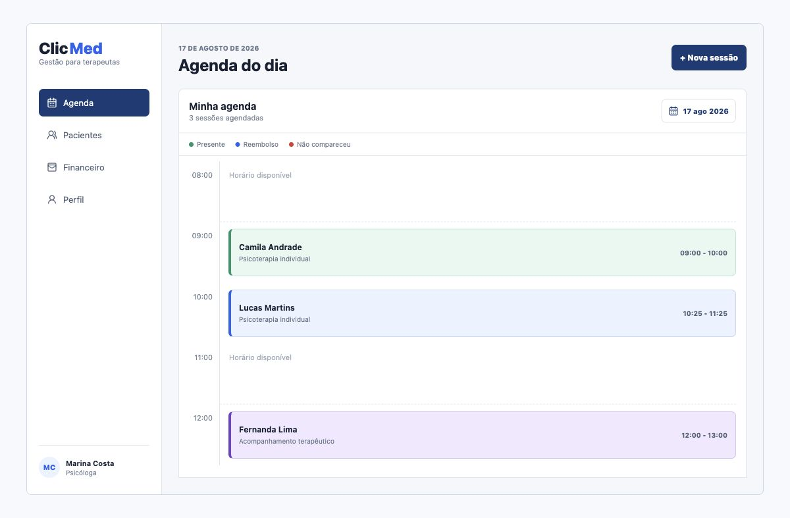
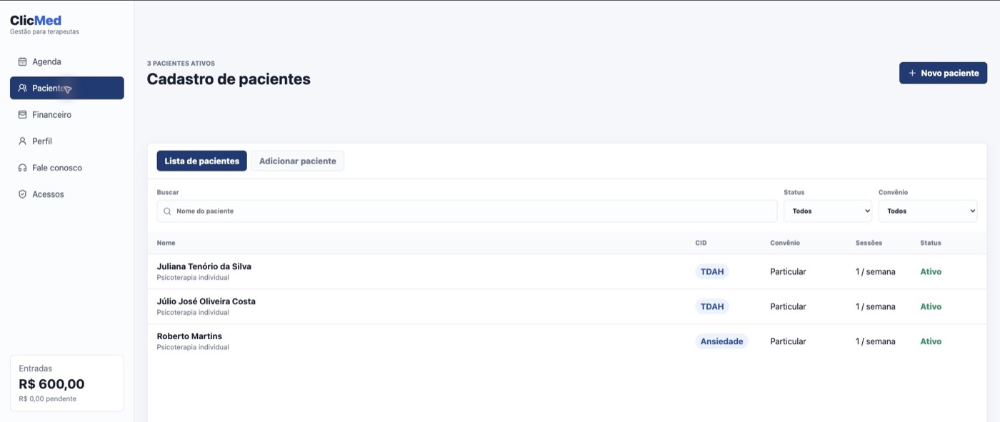
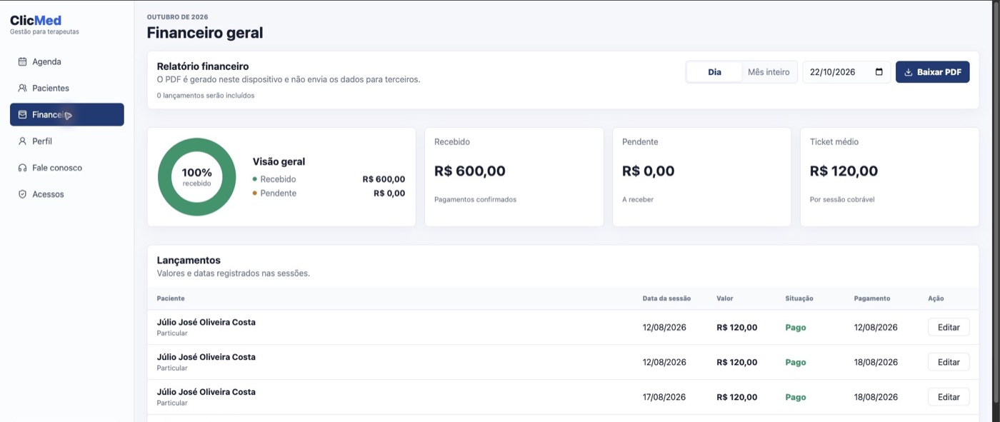

# Clic Med

Sistema web de gestão para psicólogos e terapeutas autônomos. O Clic Med reúne agenda, pacientes, acompanhamento administrativo e financeiro em uma única aplicação, reduzindo a dependência de planilhas e ferramentas separadas.

> Projeto autoral desenvolvido como produto SaaS e estudo de caso de portfólio.

[Acessar a aplicação](https://clic-med.vercel.app) · [Conhecer o produto](https://clic-med.vercel.app/conheca)

## Demonstração

### Agenda e acompanhamento das sessões



### Gestão de pacientes



### Controle financeiro e relatórios



As telas utilizam dados fictícios de demonstração.

## O que o sistema oferece

- Agenda diária com criação, reagendamento e atualização do status das sessões.
- Cadastro de pacientes, contatos, plano, frequência e informações administrativas.
- Acompanhamento do ciclo e da quantidade de sessões por paciente.
- Controle financeiro integrado aos atendimentos, com pagamentos e pendências.
- Relatórios financeiros em PDF por dia ou por mês.
- Autenticação e isolamento de dados por usuário com Supabase Auth e Row Level Security.
- Assinatura recorrente, período de teste e portal do cliente com Stripe.
- Cancelamento da assinatura dentro da aplicação e pesquisa de motivo.
- Página pública responsiva com apresentação comercial e diagnóstico interativo.
- Rastreamento de eventos de marketing com Meta Pixel.

## Tecnologias

- **Frontend:** React 19, Vite e CSS responsivo.
- **Backend e banco de dados:** Supabase, PostgreSQL e Edge Functions em Deno.
- **Autenticação e segurança:** Supabase Auth e políticas de Row Level Security.
- **Pagamentos:** Stripe Checkout, Billing Portal e webhooks.
- **Relatórios:** jsPDF e jsPDF AutoTable.
- **Deploy:** Vercel.

## Arquitetura

```text
React/Vite
   ├── Supabase Auth
   ├── PostgreSQL + Row Level Security
   ├── Edge Functions
   │      ├── criação do checkout
   │      ├── portal do cliente
   │      ├── cancelamento
   │      └── webhook da Stripe
   ├── Stripe Billing
   └── geração local de relatórios em PDF
```

Os dados de cada profissional são protegidos no banco por políticas de acesso vinculadas ao usuário autenticado. A interface não é a única barreira de autorização.

## Executando localmente

### Pré-requisitos

- Node.js 20 ou superior
- pnpm 10
- Um projeto no Supabase

### Instalação

```bash
git clone https://github.com/gabrielziver/clic-med.git
cd clic-med
pnpm install
cp .env.example .env.local
pnpm dev
```

Preencha o arquivo `.env.local` com as credenciais públicas do seu projeto:

```env
VITE_SUPABASE_URL=https://seu-projeto.supabase.co
VITE_SUPABASE_ANON_KEY=sua-chave-publica-anon
```

Execute as migrations disponíveis em `supabase/migrations` ou use `supabase/schema.sql` para criar a estrutura inicial do banco.

## Configuração das assinaturas

As Edge Functions em `supabase/functions` utilizam os seguintes secrets no ambiente do Supabase:

- `STRIPE_SECRET_KEY`
- `STRIPE_PRICE_ID`
- `STRIPE_WEBHOOK_SECRET`
- `APP_URL`

O webhook deve apontar para:

```text
https://<project-ref>.supabase.co/functions/v1/stripe-webhook
```

Chaves privadas nunca devem ser adicionadas ao frontend, ao `.env.local` versionado ou ao repositório.

## Segurança e privacidade

- As tabelas utilizam Row Level Security.
- Cada registro pertence ao usuário autenticado por meio de `user_id`.
- Relatórios financeiros são gerados localmente no navegador.
- Secrets da Stripe e a chave de serviço do Supabase ficam apenas no ambiente das Edge Functions.
- Arquivos locais de ambiente, builds e configurações de deploy estão ignorados pelo Git.

Este é um sistema de organização administrativa. Uma implantação real deve observar a LGPD e as regras profissionais aplicáveis antes de armazenar dados sensíveis.

## Roadmap

- [ ] Assistente com IA para consultas sobre agenda e rotina administrativa.
- [ ] Chat contextual dentro da aplicação.
- [ ] Lembretes e notificações de sessões.
- [ ] Novos indicadores financeiros e operacionais.
- [ ] Testes automatizados e monitoramento de erros.

## Status

O Clic Med está em evolução contínua. A versão atual já possui fluxo completo de autenticação, gestão, assinatura e deploy em produção.

## Uso do código

Este repositório é disponibilizado publicamente apenas para visualização como portfólio. O código é proprietário e não possui licença de uso, cópia, modificação, distribuição ou exploração comercial. Consulte o arquivo [LICENSE](LICENSE).

## Autor

Desenvolvido por [Gabriel Oliveira](https://github.com/gabrielziver).
